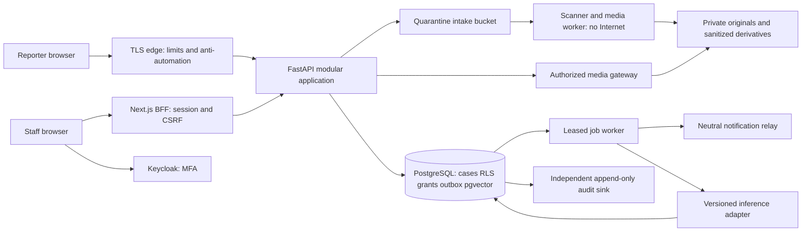
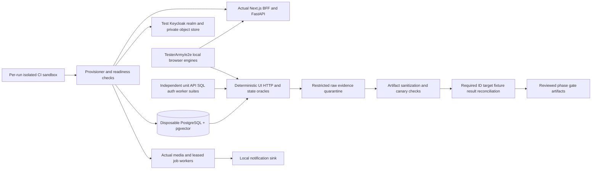

# Engineering architecture

> Current authorization: Phase 2A accepted on verified merged main `0d5abda` and exact-main CI. [Acceptance](phase2a/ACCEPTANCE.md). Phase 2B qualification preparation is technically validated and awaiting owner review on `codex/phase-2b-model-qualification`; [scope and validation](phase2b/VALIDATION_REPORT.md). No real child data, real-model execution or operational biometrics are authorized. Earlier status statements are historical.

> Current status (2026-10-25): Phase 1B is accepted on verified merged main `9fcb6ef` and required hosted CI; see [acceptance](phase1b/ACCEPTANCE.md). Phase 1C is implemented and technically validated in [draft PR #4](https://github.com/wmostafagmail/FindOurChild/pull/4), awaiting owner review. See [results and limits](phase1c/VALIDATION_REPORT.md). Synthetic data only; no Phase 2 authorization. Earlier status descriptions below are historical.

> Current status (2026-10-24): Phase 1A is accepted after PR #1 merged and required hosted CI passed on merged main `683180e`. See [acceptance](phase1a/ACCEPTANCE.md). Phase 1B is explicitly authorized on `codex/phase-1b-identity-security`; Phase 1C remains unauthorized. Earlier observations below are historical.

> Phase 1A implementation update: [review and limits](phase1a/REVIEW.md). The modular Next/FastAPI/PostgreSQL skeleton now exists. PostgreSQL stays on an internal-only network; only the non-owner API bridges to loopback access. All tenant/domain tables force RLS; only the narrowly scoped case-read policy is enabled, with other classifications/writes denied. Live identity/MFA and action policies require Phase 1B approval; reporting/media/workers require Phase 1C. A trusted transaction context is a server boundary, not protection against arbitrary SQL executed with stolen runtime credentials. The original four safeguarding sequence diagrams and architecture decisions below are unchanged.

Status: proposed, pending Phase 0 review. Repository evidence and confidence are in [the capability matrix](OPEN_SOURCE_CAPABILITY_MATRIX.md).

## Decisions and alternatives

| Decision | Recommendation | Reason and cost |
|---|---|---|
| Application | Next.js/React/TypeScript Arabic-first client + FastAPI modular backend | Bilingual UX and typed contracts; two runtimes require contract generation |
| Persistence | PostgreSQL + pgvector, exact scoped search first | Transactional case authorization, joins, backup and vector provenance in one system; ANN needs filtered-recall tests |
| Media | Private S3-compatible provider behind an adapter, KMS envelope encryption | Originals, sanitized derivatives and quarantine separated; provider/data region requires approval |
| Staff identity | Keycloak OIDC, mandatory MFA and reauthentication | Central lifecycle and phishing-resistant MFA option; dedicated operational burden |
| Jobs | PostgreSQL transactional outbox + leased worker jobs initially | Atomic domain events and modest pilot volume; implement leases, retries, cancellation and dead letters |
| Inference | Separate restricted worker process using versioned adapters | Heavy image libraries and potential GPU needs isolated from API; model selected only after evaluation/license clearance |
| Temporal | Defer to phase 4 if workflow reliability/operational measurements justify | Useful durable timers/retries; additional service and SDK deterministic-code requirements |
| Qdrant | Defer until PostgreSQL measured limits justify | Avoid a second authorization/index consistency system initially |
| Photo products | Study Immich/PhotoPrism, do not fork as case backend | Photo libraries lack our claimed-fact, safeguarding and custody domain; AGPL review required before code reuse |
| CompreFace | Study or isolated research comparator | Service API exists; older reviewed head and model provenance increase operational burden |
| Browser functional testing | TesterArmy/e2e with its Playwright-based web engine | Principal deterministic browser runner; separate API/DB/auth/security/ML/worker/performance/recovery suites remain mandatory |

No released framework version is inferred from a moving main branch. Only research dependencies are installed; application dependency locks, OCI digests and compatibility tests are a phase 1 entry deliverable. Reviewed source SHAs are frozen now.

## Components and trust boundaries



Backend domains: identity/access, organizations, reporting, case profiles, photographs/evidence, biometric processing, matching, investigations, notifications, safeguarding/approvals, audit and minimized analytics. Modules share one database with explicit application interfaces. Workers are deployment processes, not independent microservice databases. The BFF retains OIDC tokens server-side; browsers use Secure HttpOnly SameSite cookies. API validates audience/issuer/expiry/signature and live memberships/grants.

## Organization isolation and cross-registry comparison

Default searches only compare opposite registry types in the same organization and authorized case set. Supporting multiple independent NGOs requires an **opt-in federation**, a signed legal/data-sharing agreement, approved purposes, participant scopes and expiring bilateral case grants. No global index or global child identifier is exposed.

For federation, a broker worker has a dedicated database role and checks both sides' active federation enrollment, lawful basis and case-specific matching consent/authority at query time. It writes a broker-only candidate edge containing opaque case references. Origin caseworkers see a “coordination requested” task, not counterpart identity, vectors or location. Safeguarding approvers on both sides may authorize an expiring field-scoped disclosure package. Full lead details remain withheld until those approvals. Count, ranking and timing can themselves leak information; unauthorized searches get neither counts nor distinguishable existence responses.

The broker role cannot export media, alter custody, grant arbitrary access or send claimant notifications. Federation disabled by default. Tests cover unilateral opt-out, withdrawal while a job runs, overlapping grants and revocation races.

## Reporting sequence

```mermaid
sequenceDiagram
  participant R as Reporter
  participant A as Intake API
  participant D as Database
  participant Q as Quarantine
  participant W as Media worker
  participant C as Caseworker
  R->>A: Submit claims, purpose notice version, idempotency key
  A->>A: Limits, verification challenge, payload validation
  A->>D: Commit submitted case, own-report access hash, audit, outbox
  A-->>R: Neutral receipt and own-report status
  R->>A: Request upload intent with capability
  A->>D: Store bounded, expiring intent
  A-->>R: Private quarantine upload permission
  R->>Q: Upload constrained bytes
  R->>A: Complete upload intent
  A->>D: Bind immutable object version/checksum and enqueue scan
  W->>Q: Read bounded immutable object
  W->>W: Signature checks, malware scan, decode limits, EXIF policy
  alt accepted
    W->>D: Record original, sanitized derivative provenance and ready event
    D-->>C: Restricted triage task
  else unsafe or unavailable scanner
    W->>D: Quarantine; no serving or inference
  end
```

## Matching sequence

```mermaid
sequenceDiagram
  participant W as Match worker
  participant D as Database
  participant M as Model adapter
  participant R as Reviewer
  W->>D: Lease job; check current scope, legal basis and case revision
  W->>D: Load only ready images and approved selected face
  W->>M: Align, quality, embedding with pinned manifest
  M-->>W: Vector, dimensions, provenance, warnings
  W->>D: Store compatible embedding in versioned space
  W->>D: Independently retrieve scoped face and metadata candidates
  W->>W: Aggregate cases; age-aware soft reranking; reasons
  W->>D: Recheck revocation/revision; atomically publish lead run and outbox
  D-->>R: Neutral authorized review task
  Note over D,R: Cross-NGO results stay broker-only until bilateral disclosure approval
```

## Human-review sequence

```mermaid
sequenceDiagram
  participant C as Assigned caseworker
  participant A as API
  participant D as Database
  participant S as Independent safeguarding reviewer
  C->>A: Open lead with reason
  A->>D: Check tenant, case grants, restrictions, current session
  A-->>C: Permitted evidence, provenance and uncertainty
  C->>A: Record reject/hold/escalate with evidence IDs and expected revision
  A->>D: Append review, optimistic version check, audit
  alt identity investigation justified
    A-->>S: Independent assessment task
    S->>A: Confirm evidence assessment or request more evidence
    A->>D: Persist signed decision bound to evidence snapshot
  else rejected
    A->>D: Retain reason; suppress same lead revision only
  end
  Note over C,S: Scores never confirm identity; reviewer conflicts of interest prevent approval
```

## Reunification sequence

```mermaid
sequenceDiagram
  participant C as Caseworker
  participant S as Safeguarding approver
  participant H as Competent custody authority
  participant A as API
  participant D as Database
  C->>A: Propose reunion plan and identity evidence
  A->>D: Require identity-confirmed state; freeze evidence/claimant/plan revision
  S->>A: Approve child welfare, claimant verification and scoped disclosure
  H->>A: Record independently verified custody authorization
  A->>D: Verify distinct authorized signatories, scope, expiry and unchanged evidence
  alt every precondition remains valid
    A->>D: Transition to reunification_pending; issue limited contact plan
    C->>A: Record supervised handover evidence and welfare follow-up
    S->>A: Confirm completed handover
    A->>D: Mark reunited with audit
  else changed evidence, expired approval or safeguarding concern
    A->>D: Invalidate approvals; hold plan for review
  end
```

Authority evidence is recorded by authorized staff, not assumed to imply that an external authority uses the application. Off-platform evidence requires independent verification.

## Consistency, audit and failure behavior

Case mutations, audit append and outbox insert share one transaction. Consumers deduplicate by event ID and business key, use leases with heartbeat, bounded exponential retries with jitter and dead-letter review. External delivery is at-least-once; no exactly-once promise. Final authorization, deletion tombstone and case revision checks occur before publishing results or sending notifications.

Audit rows are append-only to ordinary application roles, hash chained per organization and exported to independently controlled write-once storage with signed periodic roots. This is tamper evidence and privilege separation, not mathematical immutability against all administrators. No image bytes, vector arrays, full contacts, exact custody locations or full request payloads enter logs.

Phase 0 has not run deployment, database, auth or performance tests. All proposed controls need implementation and the explicit validation gates in [TEST_STRATEGY](TEST_STRATEGY.md).

## Testing system boundary — Phase 0 correction

The production component graph, four sequences, isolation model and human approval gates above are unchanged. A separate future testing topology observes the real stack using synthetic fixtures:



Browsers run against actual service builds and actual migrated/RLS-enabled isolated test databases. Per-shard DB/realm/bucket/queue credentials and fixture hashes prevent contamination; provisioner verifies actual identities, not merely test environment flags. UI route mocking and database substitutes belong only to their explicitly separate component/unit suites.

A test-only read-only oracle can verify persisted rows, inaccessible rows, object versions, index cleanup and outbox/provider effects; it must be unreachable in production and must not introduce an application authorization bypass. Tests exercise actual non-owner API/worker roles. The test provisioner/migration role remains separate from the actors under test.

Mandatory browser assertions are deterministic, with no configured AI model; optional AI-driven synthetic navigation must still prove outcomes deterministically. Real child data never enters an external testing model or a model-backed Codex screen context. Optional telemetry is off for all processes, remote integrations are absent and test execution egress is restricted. Safe artifact publication and an independent no-missing/no-skips result gate are required.

[Framework integration](E2E_FRAMEWORK_INTEGRATION.md), [test matrix](TEST_MATRIX.md), [security catalogue](SECURITY_TEST_CATALOG.md) and [CI gates](CI_CD_TEST_GATES.md) specify the contracts. Existing references to Playwright in untouched Phase 0 specifications refer to the browser capability now delivered through TesterArmy/e2e; they do not establish a second principal runner or completed browser validation. No test topology is deployed by this documentation.
