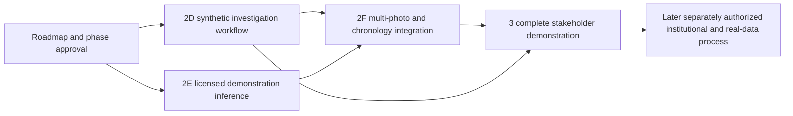

# Revised implementation roadmap — Phases 2D, 2E, 2F and 3

Version 2026-10-27, proposed for owner review. **No next-phase implementation is authorized or started.** This roadmap refines the earlier demonstration milestones while preserving all Phase 0–2B source, research, architecture, safeguarding, contracts and test evidence; the Phase 2C readiness assessment; and the existing [Phase 2D specification](phase2d/IMPLEMENTATION_SPEC.md), [contract/data proposal](phase2d/PROPOSED_CONTRACTS_AND_DATA.md) and [pending test matrix](phase2d/PROPOSED_TEST_MATRIX.md). Earlier documents remain versioned evidence, not files to discard or rewrite.

## Strategic objective and scope

Complete an actual, production-representative **Find Our Child demonstration platform** before beginning institutional operational approval processes. Fictional case management, real service integrations, licensed fictional-image inference, bilingual investigations, administration, audit, security and recovery can be developed without NGO/government operating approval or access to a real child evaluation dataset. Such approvals must not be used as a blanket reason to pause synthetic software development.

Three boundaries remain prerequisites now: explicit owner authorization for each implementation phase; verified rights for exact demonstration code/weights/images before their acquisition/use; and the existing security/privacy/safeguarding controls. Later institutional approval, real-data authority and independent child-biometric qualification gate **real operations**, not the synthetic work proposed here. No model or image restriction is waived because the project is a demonstration or nonprofit.

Remain disabled throughout: operational biometric processing, real missing-child datasets, public biometric/child search, automatic identity confirmation, custody disclosure and child release. Build and test denials and simulated staff review states without enabling those operations. A demo-review completion or fictional authority document is never actual identity/custody authority.

## Demonstration artifact decision before integration

The [licensing assessment](planning/demo/DEMO_LICENSING_DECISION.md), [exact artifact proposal](planning/demo/DEMO_ASSET_PROPOSAL.json) and [hashed primary evidence](planning/demo/research/source-lock.json) identify the proposed package:

- dlib `v20.0`, source commit `2e0b3846b4dcd0953951a9c0172503c666975229`, BSL-1.0.
- Exactly three publisher public-domain/CC0 files at dlib-models `fd81b6308a6a73d4ce08859eb2f4b628a21e27a2`: CNN detector, five-point landmarks and ResNet recognition encoder. The differently restricted 68-point landmark model and convenience model bundles are excluded.
- Syn-Vis-v0 `100262732989e77f38cd831d70a376a93735006a`: prospective 48 individual CC0 images in 24 base/headshot groups. Its curation/filename-link metadata is CC-BY-SA-4.0 and must retain separate attribution/share-alike treatment. Demographic predictions, captions and analysis cards are excluded.

Exact public grants and file identities are documented; **weights/images have not been downloaded and bytes/runtime suitability remain unverified**. Recommendation is for bounded fictional demonstration inference under publisher grants, not real-child qualification or a blanket third-party rights warranty. Training-provenance/subject-rights gaps remain visible. All eight existing blocked model profiles and current runtime flags remain unchanged. Approval of this roadmap alone should specify which phase is authorized; no artifact is acquired automatically from a planning document.

## Dependency graph and phase milestones

2D and 2E are separable workstreams and may proceed in parallel **only if the owner explicitly approves both**. 2D does not wait for an inference model; it uses the actual closed synthetic provider. 2E does not require institutional operating approval, but does require approved exact artifact acquisition and safe execution. 2F integrates both; Phase 3 closes remaining demonstration product gaps. Each phase ends with evidence and review, not automatic progression.

| Milestone | Deliverable / observable outcome | Dependency | Current status |
|---|---|---|---|
| D0 | Final synthetic workflow contracts, fixtures, access model and exact required-test inventory | 2D authorization | Proposed |
| D1 | Staff queue, paired comparison, evidence chronology and review commands on actual services/DB | D0 | Proposed |
| D2 | Collaboration, distinct-person review, audit, bilingual UX, recovery and complete regression evidence | D1 | Proposed |
| E0 | Approved notices/acquisition manifest, actual-byte hashes, safe CPU build and dependency/SBOM closure | 2E authorization and licensing packet review | Proposed; no assets acquired |
| E1 | Actual detection → alignment → quality indicators → descriptor → exact candidate retrieval | E0 | Proposed; no inference executed |
| E2 | Private demo API/worker integration, fail-safe negatives, numerical/database parity and measured hardware report | E1 | Proposed |
| F0 | Versioned multi-photo/chronology contract and family-disjoint calibration/demo fixture splits | D2/E2 accepted and 2F authorization | Proposed |
| F1 | Multi-image ranking, uncertainty, explicit synthetic open-set rejection and human investigation integration | F0 | Proposed |
| F2 | Reprocessing, stale-result invalidation, synthetic result report and full regressions | F1 | Proposed |
| 3.0 | Product-gap closure inventory, stakeholder scenarios and demo deployment/reset plan | F2 accepted and Phase 3 authorization | Proposed |
| 3.1 | Complete reporting/moderation/NGO/admin/audit/bilingual journeys with licensed inference and investigations | 3.0 | Proposed |
| 3.2 | Rehearsable stakeholder release: positive/negative journeys, accessibility, performance, recovery and release report | 3.1 | Proposed |

These are milestone dependencies, not calendar/cost promises. No actual inference speed, broad demographic coverage, longitudinal-child accuracy or production capacity is inferred from a file size, README, synthetic test or source review.

## Phase 2D — NGO matching workflow and investigation experience

### Detailed scope

Implement the existing synthetic-only proposal: dedicated staff namespace, authenticated workspace status, scenario request/status/cancel, paired-authorized lead list, comparison/media, immutable reviews, investigation timeline, structured notes, assignments, independent review and scoped audit. The proposed 14 operations and eight relations remain subject to final contract review; do not turn the disabled generic matching/disclosure/release routes on.

Display fictional evidence side by side with persistent synthetic labels, independent per-photo capture age/date intervals, source/verification state, quality-unmeasured indicators, explanations and supporting/contradictory/unknown claims. Reviewer outcomes are hold/reject/escalate; independent review records workflow progress only. No percentage suggesting identity probability. Metadata-only and insufficient-evidence cases remain reviewable without inventing a face, age or approval.

Collaboration includes assignment to an already authorized colleague, evidence requests, structured notes, conflict/recusal, current-snapshot peer review and audit history. Assignment is not an access grant. Keep closed narrative templates in this phase so the workspace does not become a new real-data upload channel. Arabic/English interfaces retain original text, RTL/LTR, keyboard focus, status announcements, mixed-script safety and 320px/zoom support.

Use the accepted FastAPI/Next/Keycloak/private-media/PostgreSQL architecture, real leased workers/outbox and existing audit transactions. A seeded fictional NGO approval state is simulation data, not an institutional endorsement. Missing memberships, paired case/media grants, correct purpose, current evidence, independence or durable audit fail safely. Org-admin role alone conveys no child/lead/media rights.

### Dependencies and technical deliverables

Preserve all old migrations/locks and append forward migrations; provision only known fixture hashes/scenarios and controlled synthetic action grants. Keep research/qualification roles and clusters inaccessible to application roles. Fixed BFF paths, closed DTOs, optimistic revisions, scoped idempotency and two-case checks must exist at API and actual SQL boundaries. Publication rechecks access/revocation, both case revisions and deletion generations. Retain at-least-once/lease/fencing semantics and explicit failure/held states.

### Tests, acceptance and stop

Implement all 20 proposed workflow features / 80 logical scenarios, expand every operation across the role/tenant/case/purpose/revocation matrix, and retain all prior suites. The eight proposed additional official TesterArmy journeys run all 24 targets; no backend route mocking. Verify actual rows, immutable events, media versions, denied cross-tenant reads, concurrency, scanner/storage/IdP/audit outage, wrong-person approval and older-backup revocation behavior.

Accept only when a permitted caseworker completes the entire synthetic investigation and an independent authorized colleague reviews it while all forbidden actions remain denied; Arabic/English and accessible layouts work; no mandatory test is skipped; critical findings are resolved; and exact-head hosted evidence is reviewable. Deliver source/migration/contract inventory, feature traceability, measured limitations, sanitized artifacts and a draft PR. Stop for owner review. This phase does not demonstrate neural facial recognition and must say so.

## Phase 2E — isolated licensed facial recognition demonstration

### Detailed scope

After explicit phase/asset approval, acquire only the selected immutable model/image files in quarantine; verify expected publisher size/Git/LFS identity, compute compressed/decompressed SHA-256, scan dependencies and freeze a signed/reviewed execution manifest before parsing. No default model package, 68-point substitution, generator download or runtime network fetch. Keep original blocked packages blocked.

Build an isolated CPU inference worker using reviewed dlib source. Execute actual CNN detection, explicit subject selection when multiple faces are present, five-point alignment and proposed explicit 150×150 RGB chips (padding 0.25, one jitter), non-neural quality indicators and native 128-component descriptor generation. Report blur/exposure/resolution/occlusion limitations honestly; no face-age, race, gender, emotion or trustworthiness inference. A no-face/multi-face/invalid-input state cannot silently become a synthetic successful detection.

Store per-image descriptors with model/component/source/transform/space versions, original/derivative hashes, organization/case and processing state in a dedicated demonstration space. Plan native L2 retrieval, not an inherited threshold or unconditional normalization. Existing unit-normalized grid space is incompatible; equal dimension 128 is not sufficient. Use exact PostgreSQL/pgvector retrieval first and compare it with an independent numerical oracle. No ANN/HNSW or extra vector service until filtered recall/capacity measurements justify it.

Expose only bounded demonstration jobs and authorized candidate DTOs to staff through a separate typed provider/route contract. This is a versioned integration change, not a hidden replacement for 2D's fixture provider or activation of existing operational matching routes. The interface explicitly distinguishes `fixture_scenario` from `licensed_demo_model`; both have `data_class=synthetic` and no identity determination. Raw vectors, model files and dataset inventory are never browser/public/notification payloads.

### Environment and data separation

Run a separate full demonstration deployment/project with its own verified instance ID, synthetic database/volumes, realm/client, object buckets, credentials, encryption keys, queues and reset fixtures. Reuse reviewed application components while preserving synthetic-only startup checks. No production or private research DSN, bucket, key or dataset is mounted; the Phase 2B lab remains separate. The current application/database has no approved operational dataset, and this phase must not create one.

Workers run nonroot with read-only approved artifacts, internal-only networks/no egress, bounded processes/memory/time and least-privilege callable functions. No external inference or testing model. An unavailable provider, corrupt artifact, changed hash, disallowed input or missing permission fails closed without CPU/GPU/model/URL fallback. Real photographs or unknown bytes cannot be processed merely because a request says synthetic. Only approved source-image hashes and their scan-bound derivative lineage are eligible.

The exact supported Python/compiler/native dependency/container combination is an E0 deliverable: do not assume the existing Python 3.13 application environment is compatible with dlib's extension. Keep native inference dependencies out of the API process. CPU x86_64 is the initial reproducibility target; arm64/GPU support is separately measured, not claimed from package metadata.

### Tests, acceptance and stop

Add actual descriptor/detection/alignment execution evidence, independently computed L2/ranking oracle comparisons, wrong-dimension/space/nonfinite vectors, no/multiple faces, changed artifact, unsafe parser input, unknown image, deleted/revoked photo and forbidden downloader/provider tests. Exercise real media/scanner/worker/DB/API paths; neural unit doubles cannot satisfy inference acceptance. Run all Phase 2D and previous regressions and every configured browser target. Missing authorized assets block this phase's inference gate; they do not erase the independently implemented synthetic workflow.

Accept only when real model stages execute on the approved fictional image subset, reproducible output/ranks and limitations are recorded, unauthorized data/models cannot execute, and required hosted suites pass on the exact review head. If the licensed model fails to detect or meaningfully rank the fixed fictional fixtures, report that outcome and revisit a rights-cleared alternative; do not relabel scripted results or select only favorable sealed-test pairs. Deliver the actual immutable dependency/artifact manifest, SBOM, private execution evidence, synthetic result report, hardware measurements, traceability and draft PR. Stop for review; no real-child qualification is implied.

## Phase 2F — multi-photograph, temporal uncertainty and open-set investigation

### Detailed scope

Support multiple independent photo records per fictional case. Preserve originals/capture-source refs and lower/upper capture-date and age-at-capture intervals separately for every image, including unknown and contradictory values. Upload date, EXIF time, case age and model appearance do not replace capture evidence. Display derived time-gap intervals with their source refs; no hard age exclusion or inferred birthday.

Implement deterministic pre-score photo budgets and case deduplication. Start with at most three gallery and three probe photographs per case, maximum-pair similarity/minimum native L2 as explicitly versioned baselines, stable tie ordering and bounded top-K. Retain per-photo omissions, failures and score orientation. More photos inflate apparent similarity, so freeze separate calibration rules for photo-count/gallery-size arms. No raw score averaging across embedding spaces.

Calibrate demonstration-only open-set rejection on the frozen fictional calibration partition, lock the threshold/policy before sealed demo testing, and return “no candidate met the demonstration threshold,” not “this child has no match.” A failed pipeline is not a correct rejection. Human investigators may retain clearly separated metadata-only leads; scores do not automatically confirm or reject identity. Record both wrong leads and missed intended fictional correspondences.

Integrate authorized comparison, explanations, review/rejection scope, evidence requests, audit, reprocessing and stale-result invalidation from 2D. A new model/transform/policy/evidence revision creates a new run; old rejection binds only its exact snapshot. Stop or invalidate work on deletion, revocation, changed evidence or incompatible spaces before publication. No cleanup can leave searchable orphan vectors; restore must not resurrect revoked artifacts/grants/results.

The initial Syn-Vis subset supports intended same-fictional-image-family pairs, not actual longitudinal aging. Demonstrate fictional historical metadata honestly. If visual age/pose sequences are needed, create a new separately reviewed fixture dataset from exact CC0-core MakeHuman assets or another properly licensed source after the phase scope explicitly authorizes creation; keep tool licenses/exports/third-party assets separate. No real child's image is age-progressed, no uncleared generative model is downloaded, and no generated age sequence is described as independent real-world longitudinal evidence.

### Dependencies, tests, acceptance and stop

Requires accepted 2D and 2E interfaces, approved asset subset, versioned space, exact retrieval oracle and group-disjoint fixture splits. Future real evaluation data is not a dependency. Freeze every base/headshot/crop/augmentation family in one partition; no model-driven label selection or sealed-test tuning. The prospective split has 8 calibration groups and 16 sealed demo groups, with enrolled/absent identities documented in the asset proposal; actual suitability is checked after authorized acquisition.

Test independent per-photo metadata, three-photo limits, duplicate capture/content, ties, quality failures, zero denominators, unknown/cross-bin dates, model/source-space changes, open-set negatives, policy/version replay, revocation/deletion races, SQL versus numerical exact rank, worker crash and restore/index cleanup. Report Recall@1/10/50, demo FPIR/FNIR, failures and workload **only as synthetic demonstration results with explicit denominators**; generated related views are correlated and do not prove missing-child accuracy, safety or subgroup robustness. Do not call a zero-event toy test a rare-error guarantee.

Accept when multi-image retrieval/rejection and the staff review journey operate end to end on the frozen fictional fixtures, changed/stale data cannot bypass checks, and every required API/DB/security/browser/regression target passes. Publish exact observed results, calibration/split/policy hashes, uncertainty/limitations and a draft PR. Stop for review. Independent authorized-data biometric accuracy remains unmeasured and pending.

## Phase 3 — complete product demonstration and stakeholder release

### Remaining application scope

First produce an explicit gap inventory against the original functional requirements; classify each item as already delivered, demo implementation needed, operationally disabled with a working denial/control, or separately authorized real-data evaluation. Reconcile all APIs/jobs/security boundaries/safeguarding workflows to tests. Do not claim the platform complete from a polished matching screen alone.

Complete integrated missing/found intake, multi-photo quarantine/scanning, reporter receipt/recovery/supplements/neutral relay, moderation, lifecycle/assignment, evidence/assertion provenance, duplicate-case investigation and revision history. Use invented identities/contacts and licensed fixture media. No unrestricted public image upload or model-facing intake is added to the demonstration; sample asset selectors still exercise the actual upload/scanner/storage paths. Unknown inputs remain quarantined/ineligible for recognition. Existing reporter access never becomes staff search or counterpart visibility.

Complete NGO administration using explicit action permissions: fictional organization lifecycle, staff roster/membership expiry/revocation, case/team assignments, access review, pending/dead-letter job visibility, synthetic privacy/deletion requests and audit inspection. Normal org admins retain no automatic case/media/custody authority. Sensitive grant/organization decisions use controlled provisioning or an explicitly reviewed distinct-person workflow; no “demo admin bypass.” Simulated org verification is labeled as such, and no real NGO/government approval is asserted.

Finish the unified Arabic/English reporting, moderation, investigation and administration experience: navigation, useful empty/error/held states, keyboard/RTL/mobile/zoom behavior, field uncertainty, evidence provenance and actionable—but safe—recovery messages. Human-reviewed translation and screen-reader sessions remain deliverables; automated browser success is not their evidence. No public child directory, hidden shelter-map lookup, third-party analytics or automatic external notification is introduced.

Provide audit timeline, scoped export/chain verification/checkpoint tools, independently keyed demonstration audit-export adapter, privacy/deletion/generation controls, backup restore, reprocessing, cancellation, task collaboration and incident/fail-safe walkthroughs. Measure chosen storage/export semantics; do not call a hash chain or object versioning “administrator-proof WORM.” Operational region/provider/KMS choices and institutional custody procedures remain later operating decisions, not reasons to omit the implementable demo controls.

### Complete stakeholder scenario pack

Deliver a reproducible seed/reset and scripted live walkthrough with actual services: fictional missing/found reports → real scan/derivative publication → moderation → actual licensed inference → multi-photo candidate review → false-lead rejection/insufficient-evidence hold → independent colleague review → permitted audit. Run the same in Arabic and English. Include negative stories for fraudulent guardian claims, query-only grants, other NGO, model/data tampering, stale approval, same-person second review, dependency failure and post-restore revocation. Show that claimant/reporter access, identity confirmation, custody disclosure and release remain denied.

All face screens display synthetic/demo status and provenance. No script may silently swap a precomputed fixture list for a failed neural stage. A workflow-only fallback is labeled and cannot satisfy the complete facial-recognition demonstration milestone. A recording or slide deck supplements the live system; it does not replace working backend/service behavior.

### Tests, acceptance and release

Run the cumulative suite, deployment/empty-install/upgrade/rollback-compatible restore, synthetic index/deletion cleanup, session and per-tenant isolation, independent artifact-sanitization checks, declared-load/performance/soak, accessibility and adversarial review. Produce the full actual feature inventory and gaps, source/locked-dependency/asset manifests, exact-head hosted CI/status-check evidence, source-bound sanitized results and original failures. Resolve critical security/safeguarding issues before release; report lower-severity findings with concrete limits, never mark them silently passed.

Accept a demonstration release only when every approved demo requirement is executable and traceable, the complete live stakeholder journey works, required tests have zero skips/missing targets, actual hardware/resource and recovery limits are measured, fixture reset/private access is reproducible, and all operational prohibitions remain tested. Create a draft release PR and stop for owner review. **Only after this review may the owner authorize starting institutional engagement, real dataset acquisition or any operational proposal.** No real child processing or production activation follows automatically.

## Cumulative testing and engineering gates

| Gate | Requirement and independent evidence |
|---|---|
| Unit/component | Domain/DTO/state/interval/aggregation/template behavior, malformed inputs, frontend focus/bidi/error handling; unit doubles are labeled and never replace integration. |
| API/contracts | Every implemented operation/request/response/error, idempotency, revision and allowed projection; real BFF/API/Keycloak and actual worker effects. |
| PostgreSQL/RLS/migrations | Actual non-owner roles; paired tenant/case/media/purpose boundaries; grants/expiry/revocation; empty install/forward upgrade; FK/space compatibility, transaction/concurrency and native restore. |
| Model-demo execution | Actual approved detector/aligner/encoder binaries, integrity/preprocessing/numerical/provider parity, wrong-space/corruption/input/download denials; no mocked inference counted as real. |
| Security/adversarial | Every sensitive action has negative authorization cases; CSRF/Origin/session/JWT, IDOR, same-person approval, arbitrary URI/model/artifact, notification/location leakage, stale/deleted/revoked work and asset-license gate failures. |
| Official browser E2E | TesterArmy/e2e **0.21.3**, web **0.15.3**, locked Playwright dependency **1.64.1**; Chromium/Firefox/WebKit × ar-EG/en-GB × 320/360/390/1280; deterministic assertions against real services/isolated migrated DB. No Playwright-only substitute. |
| Recovery/performance | Actual worker retries/fences/dead letters, OOM/timeout/dependency failure, full restore/old-backup revocation, exact/filtered retrieval, measured latency/throughput/queue behavior with safeguards enabled. |
| Publication/deployment | Exact source/lock/fixture/model/policy/run fingerprints; no real-data content or tokens in reports; sanitized screenshots/minimized traces/logs/migration/coverage artifacts; all configured required IDs/targets reconcile. Actual hosted checks/protection are verified, not inferred from YAML. |

Retain every existing required lane: currently 554 Python and 168 official browser executions in the verified Phase 2C runs. Preserve the 151-feature/630-case historical Phase 0 baseline and current 190-feature/1,216-case registry (572 passed engineering cases, 644 future cases pending). Append new requirements and executable selectors when implementation is authorized; do not relabel pending model/operational tests passed from a demo.

Proposed minimum browser expansion: eight 2D journeys (192 executions), four 2E (96), four 2F (96), six Phase 3 (144), all on 24 targets. Cumulative planned minimum: **696 executions / 232 per engine**, including the existing 168. These are planning counts, not existing/passed tests or a limit on needed coverage. Freeze actual selector×target×fixture inventories before each phase. Shard with separate DB/realm/bucket/queue fixtures if runtime demands it; do not remove browsers, targets or security checks to fit CI timeouts.

All mandatory skips, missing/zero-result lanes, failures or canceled runs block the applicable phase; no retry-to-green, `continue-on-error`, coverage exclusion or mock-to-integration reclassification. Keep both telemetry opt-out flags, zero external-model testing steps, private raw artifacts and independent publication canary/checksum gates. Maintain existing coverage floors and report changed-module/critical-policy gaps explicitly. Browser tests do not replace SQL/security, independent penetration work or biometric evaluation.

## Measured performance and acceptance budgets

Use a declared initial CPU reference target (proposed: 8 cores/16 GiB, Linux x86_64) rather than invent a supported minimum. Measure native-extension build, cold start, peak RSS, per-stage p50/p95/p99, jobs/sec, queue delay and timeout/failure rates. A proposed per-photo inference p95 budget of 5 seconds and bounded 30-second job ceiling are targets to confirm in E0, not observed performance or permission to skip difficult fixtures. GPU/arm64 and quantized exports require their own compatibility/parity evidence.

For UI/API load, plan 20 simultaneous synthetic staff sessions, 100 fictional query cases and up to 50 candidates/run; retain the 2D list metadata p95 target 1 second and comparison metadata 1.5 seconds on the stated machine. Report sample counts, confidence/variability, rejected/failed jobs and controls in force. Synthetic scale sets exercise infrastructure, not recognition accuracy. If a target fails, optimize or revise the proposed budget transparently with owner review; never bypass grants, scanning, audit or browser coverage.

## Four distinct verification reports

| Report class | What it can establish | What it cannot establish / present status |
|---|---|---|
| Functional software validation | Correct API/UI/DB/auth/worker/recovery behavior on declared fixtures, including real execution of approved inference stages | Not general identification accuracy. Existing accepted engineering evidence remains; all new phase tests are pending. |
| Facial recognition demonstration results | Actual outputs/ranks, failures, threshold behavior and resource use for the exact licensed fictional subset/model/provider | Not real-child ground truth, aging validity, fairness or production thresholds. No demonstration model has executed in this task. |
| Independent accuracy on authorized evaluation data | Future independently verified labels, subject/family/event-disjoint protocol, age-gap/open-set metrics, confidence/power and robustness on specifically authorized data | No such dataset or result exists here. Report **not measured**, not zero, passed or inferred from synthetic rates. This does not block fictional application work. |
| Operational approval requirements | Future legal/safeguarding/ethics/institution/data-sharing, real identity/guardian/custody, incident/retention/provider/release decisions for a specific operating proposal | Demo success grants none of these. Institutional processes have not been initiated by this roadmap; no real-data or custody operation is enabled. |

Every report names commit, environment, fixture/data authority, exact artifact/space/provider, executed versus pending tests, evidence hashes and limitations. User-facing demo copy must never say the platform has scientifically validated missing-child identification accuracy. Similarity/rank is an investigative signal only; no automatic identity/negative-identity/custody decision exists.

## Approval and immediate next step

Review this roadmap and licensing packet, select the specific phase(s) to authorize, and only then begin implementation on dedicated branches with review gates. Recommended next application phase is **2D**, with **2E** eligible for separately approved parallel development once the exact artifact acquisition scope is accepted. 2F and 3 remain future approvals. No institutional operating decision is requested to start fictional features; no model download or implementation is performed in this planning task.
