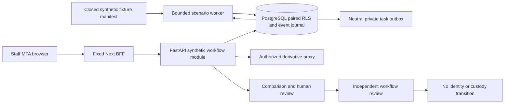

# Phase 2D — NGO Matching Workflow and Investigation Experience

Status: **proposed implementation specification, not implementation authorization**. Prepared 2026-10-27 against documentation head `aca8a2a3c9aa2fd04840caacf53086fe9bc45a76`, whose parent is accepted main `754561fed032c1438329c39e360367b7c861ffd2`. The separate Phase 2C draft PR contains only its original six documentation files. No endpoint, migration, UI, permission, model flag or dependency is changed by this proposal.

## Objective and strategic context

Deliver a production-representative staff investigation demonstration using fictional cases and **synthetic matching results only**. Institutional NGO/government operational approvals must not block features that can be built and tested safely with synthetic cases, fictional identities and appropriately licensed demonstration assets. Complete the working demonstration before beginning institutional operational approval processes. Existing legal/safeguarding design remains the eventual operational boundary; a seeded synthetic organization's `approved` database state is a test fixture, not evidence of institutional approval.

The [revised demonstration roadmap](../DEMONSTRATION_ROADMAP.md) prioritizes a future licensed working recognition demonstration, longitudinal multi-photo simulation, this NGO workflow and the integrated stakeholder demonstration. Each implementation workstream still needs explicit owner authorization. This Phase 2D proposal does not acquire or execute a recognizer: cleared demonstration models belong to a separately authorized milestone. All currently blocked model profiles remain blocked. Synthetic pixel-grid embeddings are not facial recognition, and fictional age sequences do not validate real longitudinal child identification.

Phase 2D should let authorized staff request a bounded synthetic scenario, inspect authorized paired evidence, understand provenance and uncertainty, hold/reject/escalate a lead, collaborate and obtain an independent review of the investigation workflow. It must never identify a child, change a case's identity verification, contact a claimant, disclose custody or authorize release.

## Existing evidence and architecture reused

Preserve the modular Next.js BFF / FastAPI / PostgreSQL design, Keycloak MFA, live membership/case grants, private media proxy, encrypted evidence, leased jobs/outbox and append-only audit. Use existing interfaces and locks rather than introduce a second IdP, vector database, workflow engine or notification provider. [Engineering architecture](../ENGINEERING_ARCHITECTURE.md), [Phase 1B identity boundary](../phase1b/ARCHITECTURE.md), [Phase 1C evidence/reporting](../phase1c/ARCHITECTURE.md), [Phase 2A foundation](../phase2a/ARCHITECTURE.md) and [safeguarding policy](../CHILD_SAFEGUARDING_POLICY.md) remain authoritative within their recorded scope.

The [REA research](../REA_RESEARCH_REPORT.md) supports separating guarded review interfaces from inference and keeping PostgreSQL outbox/leases initially. FindTrace's distance-to-percentage display and external descriptive request are explicit counterexamples: no probability-like match percentage, browser-only custody store, external explanation model or copied unlicensed source. Immich's two inspected interface files are boundary examples, not a reusable safeguarding backend or proof of effective RLS. Preserve their license limits; copy no third-party application code.

Phase 2A's [REA input manifest](../phase2a/research/rea-inputs.json) and [evidence](../phase2a/research/rea-evidence.json) cover only two inert BFF source files (788 AST nodes, zero parse failures, partial/unknown semantics). They support the fixed forwarding boundary, not new runtime claims. This proposal runs no new third-party target, browser surveillance, model or private artifact. Future implementation must prove the new boundary through real-service tests.

## Scope, exclusions and invariant gates

In scope: a staff-only synthetic queue; paired-case access; bounded scenario runs; side-by-side sanitized fixture evidence; per-photo age/date intervals; deterministic explanatory metadata; immutable human decisions; task assignment and structured collaboration; independent second review; audit and neutral private task events; Arabic/English responsive and accessible interfaces; recovery, concurrency and adversarial tests.

Remain disabled: real-model acquisition/loading, operational embeddings or matching, public child search, cross-NGO federation, automatic identity confirmation, guardian verification by score, child release, custody/location disclosure, operational disclosure/approval/handover APIs, external image/LLM services, claimant notifications and real-data acquisition. No generic admin or environment-variable override may bypass these restrictions.

The existing `api_19` matching-run, `api_20` lead-list and `api_21` review contracts are disabled and tied to broader biometric concepts. Keep them disabled. Build a narrowly named synthetic-workflow namespace instead of weakening their manifest/authorization contracts. Existing research-capability responses and all eight real-model flags remain disabled; expose any synthetic workspace availability through its own authenticated descriptor.

Entry checks are additive: actual synthetic DB identity and fixture-manifest hash, no operational DSNs/buckets, current staff MFA/session/introspection, active organization/membership and action permission, both case grants, allowed scenario/case revisions and known synthetic media hashes. A `synthetic=true` label or client-provided approval never satisfies them. Failure returns no sensitive projection and performs no successful transition.

## Users and authorization

| Actor | Permitted demonstration behavior | Restrictions |
|---|---|---|
| Assigned reviewer | View authorized pairs/evidence; record hold/reject/escalate; add structured fixture notes; request peer review | Explicit workflow grant plus live case/media grants; no self-approval or identity decision |
| Supervisor / independent reviewer | Assign an already authorized colleague; review an escalation independently; return for evidence or record workflow-review completion | Same paired-case boundary; canonical distinct person and conflict checks; assignment grants no access |
| Safeguarding staff | View a specifically granted synthetic concern/task and hold/recuse under the approved role policy | Role name alone gives no case, custody or workflow authority; no disclosure API enabled |
| Organization administrator | Existing organization/access metadata only | No automatic child/lead/media access, self-elevation or workflow-grant issuance |
| Reporter, claimant, anonymous visitor, other NGO | No queue, candidates, comparisons, decisions or run status | Reporter ownership, guessed IDs and verified contact confer no staff authority |
| Provisioner / worker | Provisioner seeds hash-bound fictional scenarios and grants; bounded worker consumes only approved scenarios | No browser-facing seed/import endpoint; no real-model loader; no research-lab credentials |

Use an additional closed synthetic-workflow grant with purpose `synthetic_investigation`, constrained actions and expiry. Retain existing `case_management` case grants; do not treat a grant for one purpose as a wildcard for another. Trusted server functions establish the fixed case-purpose context and separately check the fixed workflow purpose. Roles in a JWT never grant application access. New workflow grants are issued only by controlled synthetic provisioning; existing assignment and membership APIs do not become grant-issuance backdoors.

Queue rows require query and candidate `case.read`. Comparison images additionally require each case's `media.read`. Decisions require explicit workflow review rights and `case.write` on both cases; assignment additionally requires supervisor/workflow assignment rights. Independent review requires a distinct, non-conflicted canonical person, live membership and both grants. A second role or second account mapped to the same synthetic person cannot satisfy separation. Workspace audit views require both case-read and scoped audit permissions.

## Synthetic scenarios and evidence discipline

Use a closed fixture manifest provisioned outside the API. It binds scenario version, organization, fictional case IDs, registry types, case/revision and original-claim digests, each known procedural image hash/object version, per-image metadata, expected pipeline status, deterministic lead bundle, authorized staff/person bindings and policy/source fingerprints. No operational case query or private qualification dataset is imported. No API accepts arbitrary model IDs, file paths, remote URLs, graph files, embeddings or a caller-supplied candidate list.

Initial images are the 32 approved geometric fixtures, never portrayed as detected faces. Scenarios include a clearly simulated plausible lead, incorrect lead, insufficient evidence, metadata-only lead, missing/uncertain dates, multiple photos, deleted/revoked evidence, two-tenant denial and dependency outage. Realistic fictional face images or licensed recognition results are future roadmap additions requiring their own artifact clearance, explicit phase authorization and versioned fixtures; they are not silently substituted here.

Only immutable clean derivatives from the existing scanner pipeline may be served. Exact immutable versions/hashes and current media authorization are checked on every read. Originals, EXIF, embedded thumbnails, object keys, signed storage URLs, contacts, custody details and unrestricted report journals are excluded. Unknown/hash-mismatched, rescinded, quarantined or stale images are withheld. A scanner/storage/audit/authorization failure never falls back to an original, a public URL or an external service.

Use structured rationale/note codes with approved fictional evidence references and locale templates. Do not add an unconstrained free-text or image upload channel to the workspace. This deliberately limits demonstration narrative flexibility and prevents the workflow from becoming a new real-data intake surface. Existing case facts are not overwritten; a case edited outside the sealed fixture revision invalidates the scenario until a controlled new synthetic fixture revision is provisioned.

## End-to-end experience

1. Staff authenticate with the existing real Keycloak MFA flow and enter the Arabic or English synthetic investigation workspace. A persistent banner states that results and identities are fictional and no identity decision is being made. It is not dismissible.
2. The queue shows only authorized lead/task rows. Filters cover review state, assignment and registry direction; no public name/photo/custody search. Pagination and counts are computed after paired authorization. Visible ordinal ranks are contiguous; hidden rows produce no placeholders, total counts, rank gaps or counterpart references.
3. An authorized reviewer starts a known scenario from a permitted query case. A command commits a synthetic run and outbox request atomically. Progress distinguishes queued/running/held/failed/cancelled/completed and genuine empty results; failed work never appears as successful no-match.
4. The actual bounded worker validates scenario, case/evidence revisions and permissions, generates/retrieves the fixture lead bundle, and rechecks immediately before atomic publication. At most 50 distinct candidate cases per run; initial image budget is three deterministic, pre-score fixture images per case. No recognizer or biometric SQL search runs.
5. Opening a lead performs fresh paired access and durable audit checks. The comparison shows source query on one side and candidate on the other, with authorized derivative thumbnails, per-photo chronology, attributed fixture assertions and supporting/contradictory/unknown facts. Both sides stay labeled when the screen stacks vertically.
6. Explanations are deterministic templates derived from recorded synthetic sources, policy version and algorithm/scenario type. Show original rank channel, missingness and unmeasured quality. Optional raw synthetic metric uses its exact metric/space label, never a percentage or probability; no cross-space score averaging. No LLM writes explanations.
7. The reviewer chooses hold, reject or escalate with structured rationale and evidence refs. Show the exact snapshot being signed. Hold is allowed when evidence is unavailable; the UI must not force invented evidence. Reject/escalate require their defined authorized evidence/rationale preconditions. A stale snapshot requires a fresh human review, not automatic resubmission.
8. A supervisor assigns a preauthorized colleague. Collaboration records assignment, structured notes, evidence requests, recusal and resolution as immutable events. No edit silently overwrites another reviewer. A peer request is a neutral private task, not a claimant message.
9. An independent reviewer may return the investigation for evidence, disagree, recuse or mark the **synthetic workflow review complete**. This never changes case verification, emits identity confirmation or enables a disclosure/reunion endpoint. The first reviewer cannot approve their own work.
10. Staff can inspect the permitted audit timeline. Closure, deletion, access revocation or conflicting evidence makes the lead unusable/held and cancels stale work. Relevant history remains access-controlled; old rejection suppresses only the identical pair/evidence/policy snapshot, never a later justified run silently.

## States, concurrency and failure behavior

Lead review states mirror approved vocabulary: `pending`, `held`, `rejected`, `escalated`. Add explicit usability (`current`, `stale`, `revoked`) and a separate investigation state (`open`, `awaiting_independent_review`, `returned_for_evidence`, `workflow_reviewed`, `closed_without_conclusion`). Do not overload case lifecycle or introduce `matched`, `confirmed`, `reunited` or an identity probability.

Every mutation binds lead/investigation revision, both case revisions/deletion generations, run/scenario/policy versions, evidence object versions and a server-computed snapshot hash. The client echoes a revision/snapshot but cannot choose its contents. Use optimistic concurrency and scoped idempotency. Recheck live authorization before returning any cached command outcome. Identical replay is one event; changed-body reuse conflicts; stale revision is 412; conflicting workflow state is 409. Lock paired cases in canonical order to avoid deadlocks. Roll back mutation, review/audit and outbox together on failure.

Leases use fencing tokens, bounded retries and dead-letter review, with final current-grant, fixture, lifecycle and generation checks. Cancellation and revocation invalidate publication. READ COMMITTED plus fresh checks is not a promise to revoke bytes already seen or an in-flight response instantaneously. Bound transactions, revalidate before response/export, clear in-memory UI evidence on expiry/logout/authorization failure, revoke object URLs and gate browser back/restore before showing cached content. No service-worker/offline/private-page cache is added.

If IdP, database, scanner provenance, storage, audit persistence or independence checks cannot be verified, hold/deny the affected operation. Never emit a partial approval, a successful-empty search or an alternative public/model result. Demo recovery must preserve revoked permissions and rejection history; an older backup must not make a stale task actionable.

## Arabic/English and accessibility

Provide complete `ar`/`en` messages, reason templates, states and errors; preserve original attributed text separately from normalized search forms. No external translation. RTL/LTR uses logical CSS and consistent DOM order. At 320px and zoom, stack query then candidate with durable side headings; no drag-only comparison or color-only status. Keyboard users can select evidence, open comparison, navigate history and complete decisions with visible focus. Errors and asynchronous status use appropriate live regions without reading restricted content aloud.

Each photo independently shows date bounds/precision, age bounds in months/years, reference-date interval, source, verification state, synthetic flag and missingness. Unknown is not zero or today's age; uncertain bounds are not replaced by midpoints or inferred from faces/EXIF/upload time. Derived gap intervals show their input refs and uncertainty and never hard-exclude a lead. Treat contradictions as attributed claims, not automatic fraud accusations. Use `bdi`/safe text rendering for mixed Arabic, Latin IDs and numbers. Manual Arabic language and keyboard/screen-reader review remains an explicit demonstration-quality task, not a fabricated automated pass.

## Proposed architecture decisions and trade-offs

| Proposed ADR | Alternatives and decision | Trade-off / revisit trigger |
|---|---|---|
| D2D-01 — Synthetic namespace | Reuse disabled generic matching endpoints vs dedicated synthetic endpoints: choose dedicated namespace | Additional DTOs, but no ambiguous activation or weakened real-model request contract. Revisit only with approved real qualification scope. |
| D2D-02 — Dedicated workflow relations | Reuse generic leads/reviews vs additive synthetic tables: choose explicit synthetic relations bound to fixture manifests | Some conceptual duplication buys a hard data-class boundary and preserves disabled operations. No copied operational data. |
| D2D-03 — Existing modular deployment | New microservices/Temporal/Qdrant vs existing API, PostgreSQL leases/outbox and private media: choose existing stack | Shared deployment limits isolation from a compromised host; sufficient for synthetic demo, never real-data certification. Revisit measured capacity/authorized deployment. |
| D2D-04 — Closed scenario provider | Arbitrary uploaded result JSON or real inference vs versioned fixture provider: choose closed provider | Does not demonstrate facial recognition; accurately demonstrates the investigation workflow. A licensed working recognizer is a separate roadmap milestone. |
| D2D-05 — Structured collaboration | Rich/free-form messaging vs reason/note templates: choose structured fictional evidence events | Less expressive demo, smaller injection/real-data entry surface. Revisit only in an explicitly approved later scope. |
| D2D-06 — Deterministic explanations | LLM/generated advice vs source-backed templates: choose templates | Less fluent but reproducible, bilingual and no external disclosure or invented rationale. |

All ADRs are proposed for owner review, not already adopted code. [Contract/data design](PROPOSED_CONTRACTS_AND_DATA.md) supplies the implementable detail; [proposed tests](PROPOSED_TEST_MATRIX.md) define pending acceptance cases.

## Proposed implementation sequence and exit gate

After explicit owner approval only: (1) freeze fixture/permission/API schemas and executable test inventory; (2) add forward-only synthetic relations/functions and paired RLS tests; (3) implement actual scenario worker and atomic commands/recovery; (4) implement fixed BFF and bilingual comparison/review/collaboration; (5) implement independent-review/conflict/audit restrictions; (6) execute full regression, accessibility, concurrency, restore and artifact checks; (7) publish exact-head evidence and draft implementation PR, then stop for review.

No old migration or lock is rewritten. Do not install a new package until need, license, exact version/lock and compatibility are reviewed; this proposal selects no new runtime version. Existing 554 Python and 168 official browser executions remain mandatory, with all new cases appended. Proposed eight browser journeys add 192 mandatory target executions (24 targets each), yielding 360 browser executions / 120 per engine if adopted without further cases. These are future counts, not executed results. Keep deterministic assertions, no test retries or model-assisted steps, actual services/isolated PostgreSQL, disabled telemetry and sanitized artifacts. Missing/skipped mandatory results and any critical security/safeguarding failure block completion.

Proposed demo performance envelope: 20 simultaneous synthetic staff sessions, 100 query fixtures and up to 50 candidates/run; measure p50/p95/p99 and error rates with access checks enabled. Candidate list/metadata p95 target 1s and comparison metadata p95 1.5s on a declared reference machine are planning budgets, not measured guarantees; publish actual fixture/hardware/sample details. Never remove authorization or reduce browsers to meet them. Index only tenant/query/lead/state/assignment/cursor access paths supported by measurements; no new vector search.

Owner review is needed for the proposed scope, structured-note UX and independent-review semantics before implementation. Institutional operational approvals are not an entry gate for this synthetic demonstration. Asset rights and explicit implementation authorization remain mandatory. Stop after this specification; no Phase 2D code begins here.
